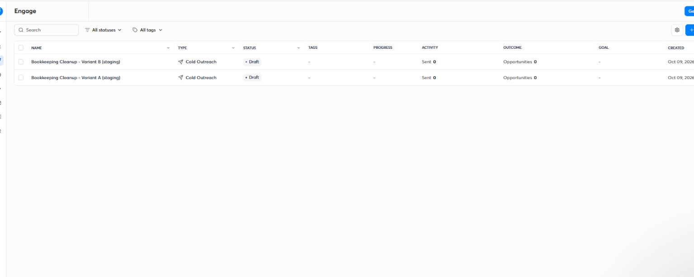
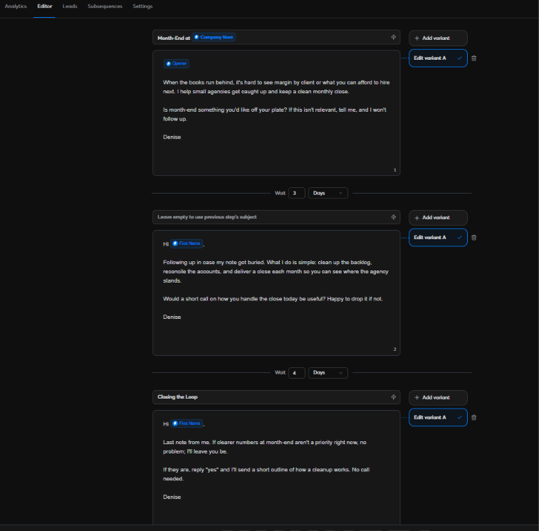
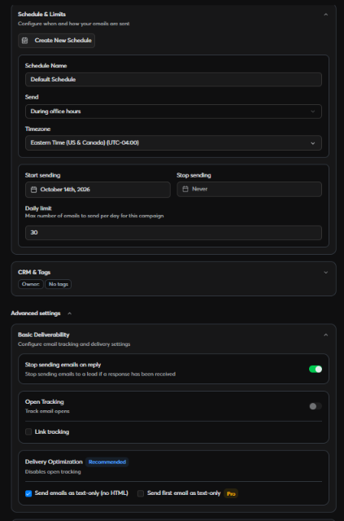
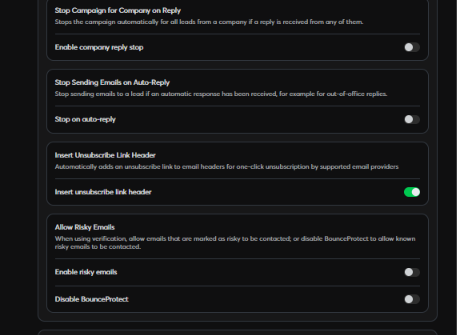
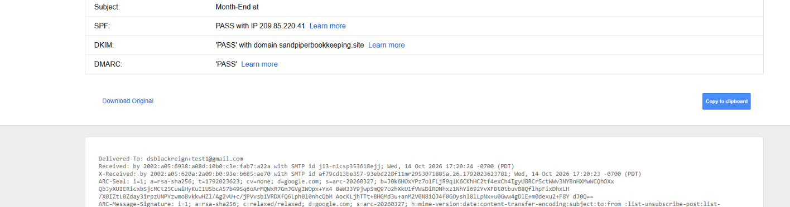
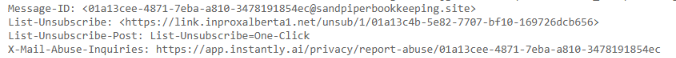
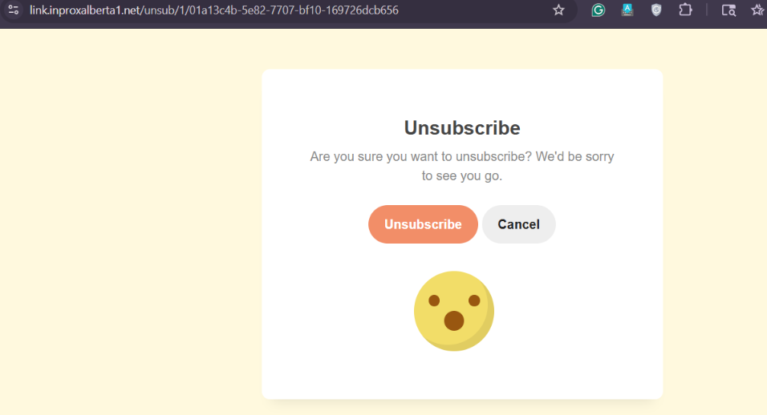

# Cold Email Campaigns: Two Variants, Built and Tested in Instantly

**Outcome:** Two 3-email sequence variants for a bookkeeping-cleanup offer, built as campaigns in Instantly and test-sent to inboxes I own. SPF, DKIM, and DMARC passed, the one-click unsubscribe headers were present, and the unsubscribe link worked. No real prospect was contacted.

## The offer
Done-for-you bookkeeping cleanup and monthly close for small US marketing agencies (11-50 employees). This is a practice offer for the portfolio.

## Rules I wrote to
- Plain text, 60-90 words per email, no images, no tracking-heavy formatting
- One soft ask per email (an interest question, not a calendar link)
- No claimed results, clients, or conversations I haven't had
- An opt-out line in every email, plus the technical one-click unsubscribe header added by the sending tool
- Merge fields: `{{opener}}` (the fact-checked line from my Clay list, which already starts with the first name), first name, and company

## Variant A: "Clean books, clear numbers"
**Hypothesis:** founders respond more to a visibility benefit (seeing margin by client and what they can afford to hire).

**Email 1 (day 0)** | Subject: `month-end at {{company}}`
```
{{opener}}

When the books run behind, it's hard to see margin by client or what you can afford to hire next. I help small agencies get caught up and keep a clean monthly close.

Is month-end something you'd like off your plate? If this isn't relevant, tell me and I won't follow up.

Denise
```

**Email 2 (day 3)** | Subject: blank, so it sends in the same thread
```
Hi {{first_name}},

Following up in case my note got buried. What I do is simple: clean up the backlog, reconcile the accounts, and deliver a close each month so you can see where the agency stands.

Would a short call on how you handle close today be useful? Happy to drop it if not.

Denise
```

**Email 3 (day 7)** | Subject: `closing the loop`
```
Hi {{first_name}},

Last note from me. If clearer numbers at month-end aren't a priority right now, no problem, I'll leave you be.

If they are, reply "yes" and I'll send a short outline of how a cleanup works. No call needed.

Denise
```

## Variant B: "Agency-specific pain"
**Hypothesis:** agency-specific language gets more replies because it signals relevance.

**Email 1 (day 0)** | Subject: `agency bookkeeping`
```
{{opener}}

Retainers, freelancers, and project billing make agency books messy fast. I do bookkeeping cleanup and monthly close for small agencies.

Is bookkeeping handled in-house, or by someone outside the team? If this isn't relevant, tell me and I won't follow up.

Denise
```

**Email 2 (day 4)** | Subject: blank, so it sends in the same thread
```
Hi {{first_name}},

A common snag for agencies is matching contractor payments and retainer income to the right client and month. I set that up so close doesn't turn into a scramble.

Worth a quick reply on how you handle it today?

Denise
```

**Email 3 (day 9)** | Subject: `should I close this out?`
```
Hi {{first_name}},

I'll stop here so I don't clutter your inbox. If bookkeeping is already sorted, great.

If it ever isn't, reply and I'll send a short outline of how I'd approach it.

Denise
```

## Test plan
- **Split:** half the list gets A and half gets B, assigned at random, with the same send times and the same mailbox setup
- **Measure:** positive replies per 100 delivered (the main number), total reply rate, bounce rate, and unsubscribes. I wouldn't use opens, since open tracking is unreliable
- **Sample size:** my list has 10 contacts, which is far too few to call a winner. A real test needs a few hundred delivered emails per variant. This plan shows how I'd run it, and I'm not claiming results
- **Decision rule:** pick the variant with more positive replies once each has enough volume, then test one change at a time (subject line, first line, ask)
- **Guardrails:** keep bounces and spam complaints very low, pause a variant if either rises, and verify every list before sending

## Build in Instantly
Each variant is its own campaign, so every lead receives one whole sequence and the split stays clean. Both were built as drafts first, using a lead file of fake names and plus-addressed variants of inboxes I own.

**Settings**
- Plain text, with open tracking and link tracking off
- Stop sending on reply
- One-click unsubscribe header on
- Bounce protection on, risky emails excluded
- 30 emails a day per campaign, with a lower cap on new leads so follow-ups have room
- Weekdays and business hours only, with a 9-minute minimum gap plus a random extra between sends






## Self-test: a send through my own domain
To test real sending, I connected a Google Workspace mailbox on my practice domain to Instantly and sent Variant A to three test addresses that I own. My earlier free Zoho mailbox had no IMAP/SMTP access, so it couldn't connect.

**Confirmed**
- SPF, DKIM, and DMARC all passed on the delivered messages (checked in Gmail's "Show original")
- The `List-Unsubscribe` and `List-Unsubscribe-Post` (one-click) headers were present
- The unsubscribe link from the header opened a page that let me unsubscribe
- The opener, first name, and company merged correctly, with no stray characters
- The messages went out as plain text
- All three test messages reached my inbox Primary tab, not spam





**Not confirmed**
- Gmail did not show its own Unsubscribe link next to the sender name, even though the header is there
- Inbox placement for recipients other than me. These were my own addresses, and I had already exchanged mail
  with the sender, so the result says little about how a stranger's filter would treat a brand-new domain with
  no sending history
 
## What broke
- **A launched campaign didn't send.** Instantly's Diagnose showed it was outside its sending window and paused. I widened the window for the test and restored it afterward
- **My first launch sent two emails to test addresses I couldn't open.** I corrected the lead addresses and re-ran the test from a duplicate campaign
- **The sent copies in the sending inbox showed no SPF/DKIM results.** The receiving server adds those, so I checked a copy delivered to an outside inbox
- **My CSV imported the openers with stray quotation marks**, which would have opened every email with a `"`. I caught it in the lead table before building the sequences
- **Step 2 had a second variant enabled by default**, which would have mixed A and B inside one sequence

## Before any real send
- Warm up the mailboxes gradually, and keep daily volume low
- Use a real offer and identity, and add a physical address and sender details (check current CAN-SPAM requirements)
- Review dmarcian's reports to confirm nothing unexpected sends as my domain
- Re-check every merged fact against the company's own site
- Verify the list, and remove bounces before sending

## What I'd improve
- Use hiring signals (for example, a posted finance role) as a trigger for a third variant
- Add a LinkedIn touch between emails 1 and 2
- Run the split on a few hundred contacts per variant, and judge on positive replies

See also the [launch checklist](launch-checklist.md).
