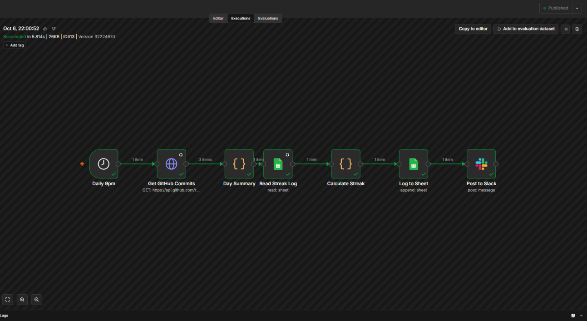
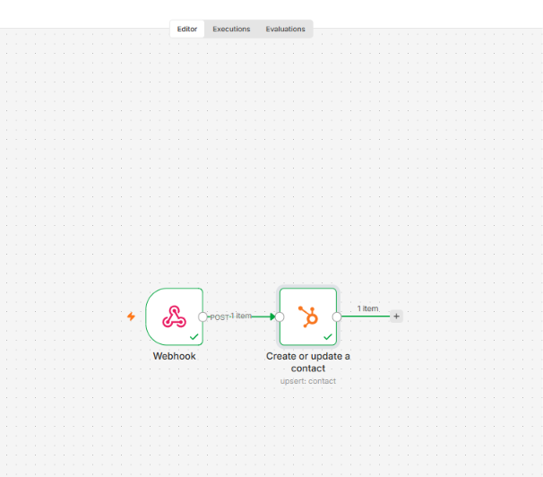
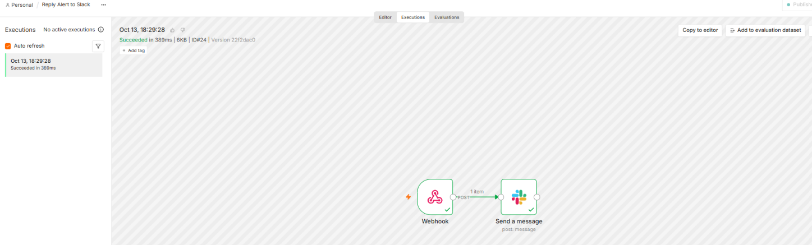

# n8n Workflows

Three workflows built in n8n Cloud while learning GTM automation. All testing used fake data.

| Workflow | What it does | File |
|---|---|---|
| Daily Streak Tracker | Checks my builds repo for commits each night, calculates a work streak, logs it, and posts to Slack | `daily-streak-tracker.json` |
| Clay Lead to HubSpot | Receives a lead by webhook and creates a HubSpot contact with Lead source = Clay | `clay-lead-to-hubspot.json` |
| Reply Alert to Slack | Receives a reply by webhook and posts an alert to a Slack channel | `reply-alert-to-slack.json` |

Credentials (Google Sheets, Slack, HubSpot) are stored in n8n and are not in these files.

---

## 1. Daily Streak Tracker
**Problem:** Keep myself accountable during a 7-day build sprint with a log I can't quietly skip.

**Flow:** Schedule (9pm, Jamaica time) > GitHub commits API > Day Summary (Code) > Read Streak Log (Google Sheets) > Calculate Streak (Code) > Log to Sheet > Post to Slack

**How it works**
- Pulls commits made since midnight from the public GitHub API for my builds repo
- Collapses the list into one summary: worked or not, commit count, latest commit message
- Reads the previous row of the log and adds one to the streak on a worked day
- Rest-day rule: one no-commit day in the last six logged days holds the streak instead of resetting it
- Appends a row to a Google Sheet and sends the result to Slack

## 2. Clay Lead to HubSpot
**Problem:** an enriched lead from a prospecting table should land in the CRM without copy and paste.

**Flow:** Webhook (POST) > HubSpot: Create or Update Contact

**How it works**
- The webhook receives JSON with first name, last name, email, company, and an opener
- The HubSpot node matches on email, so a repeat lead updates the same contact and doesn't create a duplicate
- Sets a custom contact property, Lead source, to `Clay`

**Tested with:** a fake lead sent from a PowerShell script. The contact appeared in HubSpot with Lead source = Clay.

## 3. Reply Alert to Slack
**Problem:** A positive reply should reach me quickly, in the place I'm already looking.

**Flow:** Webhook (POST) > Slack: send message

**How it works:** The webhook receives a name, company, and reply text, and the Slack node posts them to an alerts channel.

**Tested with:** A fake reply through the production webhook URL. n8n returned "Workflow was started", the message appeared in Slack, and the run showed as successful in Executions.

---

## What broke, and what I did
- **HubSpot had moved UI-created private apps to "Legacy,"** so I couldn't follow the usual private-app route. Instead I signed in to HubSpot directly from the n8n node while setting it up, which created the connection without a token.
- **The Lead source property didn't show as a column in HubSpot.** The workflow had written the value, but I had to add the column to the table view to see it.
- **My test command failed in Command Prompt**, because `Invoke-RestMethod` only exists in PowerShell.
- **A typo in the webhook path** (an extra letter) returned a 404. The error message named the exact path it couldn't find, which is how I spotted it.
- **Test URLs only respond while n8n is listening**, and only once. Production URLs need the workflow switched on.
- **Pasting error text back into the terminal** caused confusing parser errors. I now keep test commands as variables in a text file.
- **An intermittent connection error** on the first production call went away before the call succeeded.

## Limits
- Everything was tested with fake payloads. Neither Clay's webhook column.
- HubSpot is connected through a sign-in, so the connection is tied to my account and can be revoked from HubSpot's connected-apps settings.
